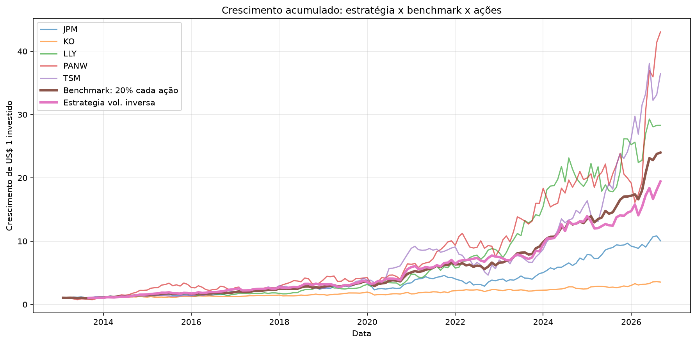

# Long-Only: 2 de 5 ações com momentum

Backtest de estratégias **long-only** que mantêm sempre **2 de 5 ações** em carteira (100% compradas, sem alavancagem), comparadas a um benchmark igualmente ponderado e rebalanceado todo mês.
Projeto de um desafio técnico de estratégia quantitativa. O foco é o **método** (premissas claras, ausência de look-ahead, custos e análise crítica dos resultados), e não a lucratividade.

> **Aviso:** material educacional. Não é recomendação de investimento. Resultados passados, sobretudo de um universo escolhido com visão posterior, não garantem resultados futuros.

## Resumo

- **Universo:** LLY, PANW, TSM, KO e JPM (preços diários ajustados, em USD).
- **Seleção das ações (igual nas duas estratégias):** momentum de 6 meses (pulando o último mês) + filtros de tendência; a cada mês, escolhe as 2 melhores.
- **Estratégia 1 (`results/v1`), pesos por busca no treino:** a 2ª ação recebe um peso inteiro entre 20% e 50% e a 1ª recebe o complemento. O peso é escolhido pelo **maior Sharpe no período de treino**.
- **Estratégia 2 (`results/v2`), pesos por volatilidade inversa:** cada ação recebe peso inversamente proporcional à sua volatilidade recente (60 pregões). Não há parâmetro escolhido no treino.
- **Benchmark:** 20% em cada ação, rebalanceado mensalmente (o S&P 500, via SPY, entra como referência extra).
- **Conclusão:** A estratégia 1 superou a amostra, entretanto, o viés de seleção impactou bastante. Saber o futuro já deu a essa estratégia uma vantagem larga. A estratégia dois, dado o critério de divisão de peso entre as amostras, teve menor retorno mais um menor drawdown e volatilidade comparado a estratégia 1 e até mesmo ao benchmark. Entretanto, dado o obtido pelo benchmark, não há indicios estatísticos suficientes para que uma das estratégias propostas seja escolhida, nas circustâncias testadas.

## Estrutura do repositório

```
.
├── src/long_only_v1/        # código das estratégias (importável)
│   ├── config.py            # tickers, datas, período de treino, grade de pesos, janela de volatilidade, taxa livre de risco
│   ├── data.py              # download e validação dos preços
│   ├── returns.py           # retornos diários/mensais e benchmark
│   ├── strategy.py          # seleção, pesos e retornos das duas estratégias
│   ├── metrics.py           # Sharpe, drawdown e demais métricas
│   ├── costs.py             # turnover e custos de transação
│   ├── robustness.py        # primeira e segunda metade de cada período
│   └── plots.py             # gráficos
├── notebooks/               # análise completa, com texto e gráficos
├── scripts/run_backtest.py  # reproduz tudo por linha de comando
├── tests/                   # testes automatizados (sem internet)
└── results/
    ├── v1/                  # estratégia 1 (busca de pesos): tabelas (.csv) e figuras (.png)
    └── v2/                  # estratégia 2 (volatilidade inversa)
```

O pacote se chama `long_only_v1` e contém as duas estratégias; "v1" e "v2" nas pastas de resultados se referem às **estratégias**.

## Como reproduzir

Na raiz do projeto:

```bash
python -m venv .venv
source .venv/bin/activate          # Windows: .venv\Scripts\activate
pip install -r requirements.txt
pip install -e .
```

**Pelo script:**

```bash
python scripts/run_backtest.py                          # estratégia 1 -> results/v1/
python scripts/run_backtest.py --strategy inverse_vol   # estratégia 2 -> results/v2/
python scripts/run_backtest.py --use-cache              # guarda/usa uma cópia local dos preços em data/raw/
```

**Pelo notebook:** instale `requirements-dev.txt`, abra o notebook com o kernel do ambiente e use *Restart & Run All*.

A janela de dados é **fixa** (de 2013-01-01 até 2026-10-01, com `end` exclusivo, então o último pregão é 30/09/2026). Os preços ajustados do Yahoo podem variar um pouco com novos dividendos; use `--use-cache` para congelar os dados.
Os parâmetros (datas, período de treino, grade de pesos, janela de volatilidade) ficam em `src/long_only_v1/config.py`.

## Metodologia e premissas

**Dados**
- Preços diários ajustados (`auto_adjust=True`), em dólares, via `yfinance`. As ações foram escolhidas pelo autor (setores diferentes), com visão posterior.
- Período: janeiro/2013 a setembro/2026 (o último mês é completo).

**Seleção das ações (decidida no fechamento do mês *t* e aplicada ao mês *t+1*)**
1. **Momentum:** `P(t-1) / P(t-7) - 1` (6 meses, ignorando o mês mais recente).
2. **Filtros:** momentum positivo e preço acima da média móvel de 200 dias.
3. **Seleção:** as 2 melhores que passam nos filtros. Se menos de 2 passam, completa-se pelo ranking de momentum (a carteira sempre tem 2 ações).
4. **Rebalanceamento:** mensal, sem alavancagem e sem venda a descoberto.

**Estratégia 1: pesos por busca no treino**
- A 2ª ação do ranking recebe `w` e a 1ª recebe `1 - w`, com `w` inteiro entre 20% e 50%.
- `w` é o valor de maior Sharpe no período de treino; o teste não participa dessa escolha.

**Estratégia 2: pesos por volatilidade inversa**
- Para as duas ações escolhidas, `w_a = (1/σ_a) / (1/σ_a + 1/σ_b)` e `w_b = 1 - w_a`.
- `σ` é o desvio padrão dos retornos diários nos últimos 60 pregões (`VOL_WINDOW` no `config.py`), medido no último pregão do mês; a ação menos volátil recebe o maior peso.
- Se a volatilidade de alguma das duas não estiver disponível (NaN ou zero), usa-se 50%/50%.
- Não há piso nem teto de peso, e a janela é fixada a priori (não é escolhida pelo resultado).

**Treino e teste**
- Treino: set/2013 a jun/2021. Teste (fora da amostra): jul/2021 a set/2026.

**Métricas**
- Sharpe anualizado = `√12 × média(r - rf) / desvio(r - rf)`, com retornos mensais e taxa livre de risco fixa de 4% ao ano.
- Também: retorno acumulado e anualizado, volatilidade, máximo drawdown (mensal).

**Custos**
- 0, 5, 10 e 25 bps **por lado**, sobre o total negociado, usando o turnover mensal.
- O turnover ignora o *drift* dos pesos durante o mês (subestima o real). Na estratégia 2 os pesos mudam todo mês (a volatilidade muda), então o turnover tende a ser maior.

**Execução**
- Supõe-se que as ordens são executadas ao preço de fechamento do último pregão do mês, sem *slippage*, impostos nem câmbio.

## Resultados

<!-- PREENCHER depois de rodar: copie as tabelas de results/v1/tables/ e results/v2/tables/ -->

| | Estratégia 1 (busca de pesos) | Estratégia 2 (vol. inversa) | Benchmark | SPY |
|---|---|---|---|---|
| Sharpe (treino) | 1.31 | 1.05 | 1.25 | 0.83 |
| Sharpe (teste) | 1.23 | 1.03 | 1.49 | 0.62 |
| Retorno anualizado (teste) | 34.6% | 25.9% | 31.8% | 13.1% |
| Máx. drawdown (teste) | -17.8% | -13.9% | -15.0% | -23.9% |
| Turnover médio mensal | 0.249 | 0.250 | – | – |




Todas as tabelas e figuras ficam em [`results/v1/`](results/v1/) e [`results/v2/`](results/v2/).

## Limitações

- Apenas 5 ações, escolhidas com visão posterior: os números absolutos não se generalizam.
- Um único corte treino/teste, sem walk-forward.
- Parâmetros de momentum (6 meses), média móvel (200 dias) e janela de volatilidade (60 pregões) fixos; na estratégia 1, apenas o peso é escolhido no treino.
- Duas estratégias comparadas: ao olhar mais de uma variante, aumenta a chance de uma parecer melhor por acaso.
- Custos estimados e aplicados só à estratégia; o turnover ignora o *drift* dos pesos.
- Na estratégia 2, sem limite de peso, a ação mais volátil pode ficar com uma fatia pequena; a volatilidade inversa também ignora a correlação entre as ações (o que não necessariamente é ruim).
- Métricas calculadas em retornos mensais: drawdown e volatilidade intramês ficam subestimados.
- Taxa livre de risco constante (4% ao ano).
- Com ~13 anos e 5 ações, a incerteza estatística é grande: diferenças pequenas de Sharpe entre estratégia e benchmark não são conclusivas.

## Possíveis melhorias

- Curva diária com rebalanceamento mensal e drawdown diário.
- Teste placebo (sortear 2 das 5 ações) e bootstrap em blocos para a diferença de Sharpe.
- Análise de sensibilidade (janelas de momentum, média móvel, volatilidade de 30/60/90 pregões, pesos) e limites mínimo/máximo de peso na estratégia 2.
- Estimadores de volatilidade alternativos (por exemplo, média móvel exponencial) e uso da correlação entre as ações.
- Universo maior, definido por regra objetiva, para reduzir o viés de seleção.
- Taxa livre de risco real, custos também no benchmark e turnover com *drift*.
- Métricas de cauda (VaR e CVaR).

## Testes

```bash
pip install -r requirements-dev.txt
pytest
```

Os testes usam preços sintéticos (não precisam de internet) e verificam, entre outras coisas: sempre 2 posições e 100% investido, ausência de look-ahead, que a escolha do peso não usa o período de teste, a fórmula dos pesos por volatilidade inversa, que as duas estratégias escolhem as mesmas ações, o cálculo do Sharpe e do drawdown, e o turnover e os custos.

## Uso de IA

<!-- AJUSTE ao que de fato aconteceu -->
Ferramentas de IA foram usadas como apoio (revisão, organização do código e testes). Além disso, sugestões de melhoria, criação do slide e a organização do repositório também passaram por IA. Entretanto, a revisão final foi feita manualmente. 